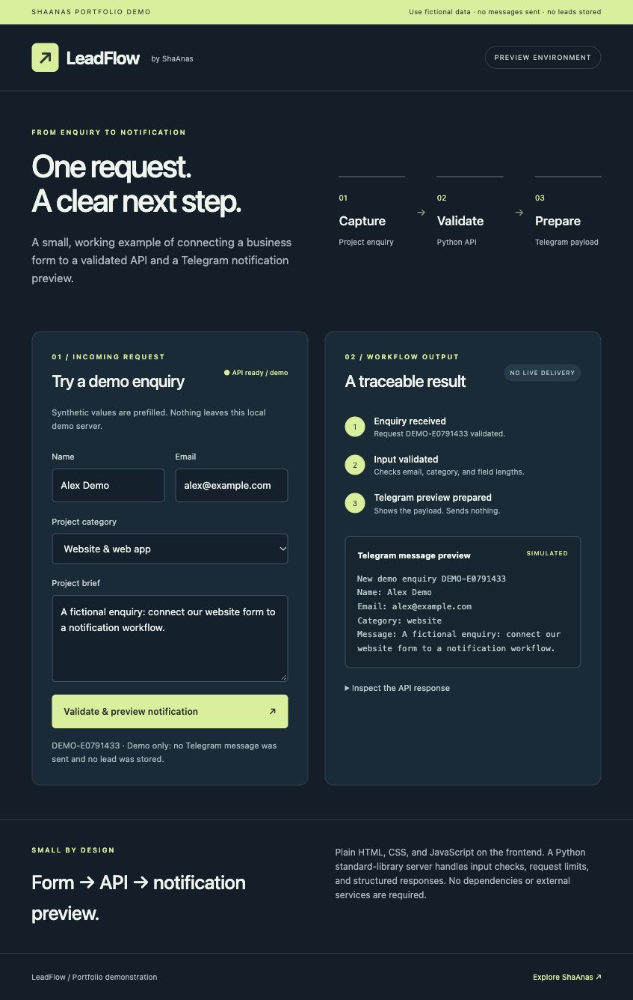

# LeadFlow — API & Telegram notification preview



A working local example of **form → validated Python API → Telegram message payload**. Created from scratch as a ShaAnas portfolio project. The Telegram step is deliberately a preview adapter: it performs no network calls and sends no messages.

## Run
Requires Python 3.9 or newer and a modern browser. No packages or tokens are required.
```sh
python3 server.py
```
Open http://127.0.0.1:8000. Optional: `python3 server.py --port 8001`.

## Try it
1. Keep the prefilled synthetic enquiry and submit it.
2. Observe the workflow steps, unique demo ID, message preview, and JSON response.
3. Change the category and submit another enquiry.
4. Try an invalid email, missing name, or brief shorter than 10 characters.

## API
`GET /api/health` reports demo mode. `POST /api/leads` accepts only JSON with exactly four string fields:
```json
{
  "name": "Alex Demo",
  "email": "alex@example.com",
  "category": "integration",
  "message": "Connect a fictional website form to a notification preview."
}
```
Categories: `website`, `ecommerce`, `integration`, `automation`. Success: HTTP 201, `status: validated`, `notification.mode: preview_only`, `notification.sent: false`. The payload shows the `sendMessage` method's `chat_id` and plain-text `text`; no actual chat ID or token is configured. No Telegram SDK or protected adapter is included.

Errors: 400 invalid fields or JSON; 411 missing/invalid content length; 413 empty/oversize body; 415 wrong content type; 429 more than 20 attempts per minute from one address. Unknown routes and source files return 404. The API does not expose a lead-list endpoint.

## Tests
```sh
python3 -m unittest -v
```
Tests exercise real HTTP requests against an ephemeral local server: success, preview-only semantics, malformed JSON, invalid UTF-8, schema and length checks, content type, size limit, rate limit, static routes, and file exposure boundaries.

## Data and security boundaries
- The server binds to `127.0.0.1`; it is a local demo, not a production hosting stack.
- Contact input is echoed only to the requesting browser, never persisted or logged. Use fictional details.
- Short-lived request timestamps are kept in memory for a demo rate limit.
- Output is rendered with `textContent`, with no HTML/Markdown interpretation of enquiry fields.
- Exact static-file allowlist, body limits, read timeout, no-store responses, and a restrictive content policy are included.
- No external requests, bot tokens, API keys, client data, ShaNas Core, or proprietary adapter code are included.

A production integration needs reviewed hosting, authentication where appropriate, abuse controls, retention and consent policy, monitoring, durable queue/idempotency, and an explicitly configured delivery adapter. This demo makes no production-security or live-delivery claim.

Built by [ShaAnas](https://shaanas.com). Public portfolio demonstration; no license grant is implied.

## Validation recorded
Checked on 2026-10-16: browser walkthrough at desktop and 390px mobile width; no horizontal overflow. All 10 API test cases passed.
